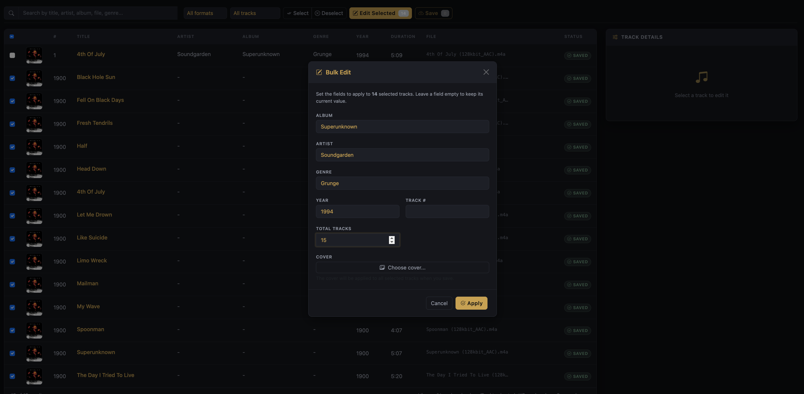

<p align="center">
  
</p>

# Audio Metadati Manager

Audio Metadati Manager is a web-based application for managing your music library's metadata and album artwork. Python (via [mutagen](https://mutagen.readthedocs.io/)) performs all the audio operations, while PHP provides the web/API layer and a modern responsive interface built with HTML5, Bootstrap 5 and vanilla JavaScript.

A command-line interface (CLI) for the same Python core is also included.

## Version

**1.2.0** — Added built-in audio player with play/pause, seek, progress bar, time display, volume control; always-visible play button per track; single-track playback.

## Changelog

### 1.2.0
- **Audio player**: global HTML5 player with play/pause, next/previous, seek bar, current time/duration, volume/mute
- **Per-track play button**: dedicated always-visible column with Play/Pause button for each track
- **Single-track playback**: only one track plays at a time; starting a new track stops the previous one
- **Range request support**: audio endpoint serves MP3, FLAC, M4A with HTTP Range for seeking

## Features

- Web-based audio metadata management
- Command-line interface (CLI) included
- MP3, FLAC and M4A support
- Edit metadata: title, artist, album, album artist, track number, total tracks, genre, year
- Bulk editing of multiple tracks at once
- Search across title, artist, album, genre and filename
- Filter by format (MP3/FLAC/M4A) and status (unsaved/saved)
- **Built-in audio player**: play tracks directly from the library with a global HTML5 player (play/pause, next/previous, seek/progress bar, current time/duration, volume/mute); per-track Play/Pause button; single-track playback
- Album cover management:
  - JPEG/JPG files in the same folder as the audio are detected automatically (case-insensitive)
  - Choose between the available images
  - Upload a new JPEG from the cover selector; uploaded files get a free name and never overwrite existing images
  - Embed the selected cover into the audio file when saving (original JPEG is never modified)
  - Bulk edit reuses the cover selector for all selected tracks in the same folder and applies the chosen cover on save
  - Remove an embedded cover without deleting the source JPEG
  - No automatic cover downloads from the Internet
- Clear unsaved/saved status indicators
- Elegant, responsive dark UI (desktop, notebook, tablet)
- Usable over a local network (LAN)

## Screenshots

### Main interface


### Bulk changes



## Architecture

```
Browser
   |
   v
HTML + Bootstrap + JavaScript
   |
   v
PHP API
   |
   v
Python audio core (mutagen)
   |
   v
Audio files
```

- **Browser** – the responsive interface built with HTML5, Bootstrap 5 and vanilla JavaScript.
- **PHP API** – validates input, secures paths, and executes the Python core as a subprocess. It is the only web-facing layer.
- **Python core** – `python/core.py` reads and writes audio metadata and embedded covers using mutagen. The `python/comm.py` module exposes a JSON command-line interface that PHP calls.
- **Audio files** – never re-encoded; only metadata tags and embedded artwork are modified, and only when you explicitly save.

## Requirements

| Component | Requirement |
|-----------|-------------|
| Python | 3.8 or newer |
| PHP | 8.0 or newer |
| Python package | `mutagen` (see `requirements.txt`) |
| Browser | A modern browser (Chrome, Firefox, Safari, Edge) |
| OS | Linux, macOS, or Windows (PHP and Python must be installed) |

No PHP extensions or Composer are required. The application uses only the PHP built-in web server.

## Installation

### Docker (Recommended for Home Servers)

The easiest way to run the application is using Docker Compose.

#### Quick Start (uses default `./music` folder in the project)

```bash
git clone <repository-url>
cd audio-metadati-manager
mkdir -p music          # create a music folder in the project (or use your own)
docker compose up -d --build
```

Then open [http://localhost:8000](http://localhost:8000) in your browser.

---

### Using Your Own Music Folder (Recommended)

For a persistent library outside the project, configure an absolute path on your host:

1. **Create your local configuration**

   ```bash
   cp .env.example .env
   ```

2. **Edit `.env` and set `MUSIC_PATH` to the absolute path of your music folder**

   ```bash
   # macOS / Linux
   MUSIC_PATH=/home/yourname/audio-metadati-manager/music

   # Windows (use forward slashes)
   MUSIC_PATH=C:/Users/yourname/audio-metadati-manager/music

   # Linux server
   MUSIC_PATH=/srv/audio-metadati-manager/music
   ```

   > **Important:** Use an **absolute path** on the host. Docker Compose does **not** expand `~` (tilde).
   > The folder **must already exist** on the host. If it doesn't exist, Docker will create an empty one.

2. **Start the application**

   ```bash
   docker compose up -d --build
   ```

3. **Access the application**

   Open your browser and go to: [http://localhost:8000](http://localhost:8000)

---

### Portainer Deployment

The application works seamlessly with Portainer. Since Portainer manages Docker Compose stacks, you have two options:

#### Option A: Stack from Repository (Recommended)

1. In Portainer, go to **Stacks** → **Add stack**
2. Set **Name**: `audio-metadati-manager`
3. Set **Build method** to **Repository**
3. Enter your repository URL and branch
4. In **Environment variables**, add:
   - `MUSIC_PATH=/path/to/your/music`  (absolute path on the **Portainer host**)
   - `PORT=8000` (optional, defaults to 8000)
4. Click **Deploy the stack**

> **Important for Portainer:** The `MUSIC_PATH` must be an **absolute path on the Portainer host** (the machine where Docker runs). Portainer does **not** expand `~` (tilde). The folder must exist on the Portainer host and be accessible to Docker.

#### Option B: Stack from Local Compose File

1. In Portainer, go to **Stacks** → **Add stack**
2. Set **Build method** to **Web editor**
3. Copy the contents of `docker-compose.yml` into the editor
3. In **Environment variables**, add:
   - `MUSIC_PATH=/path/to/your/music` (absolute path on the Portainer host)
   - `PORT=8000` (optional)
4. Click **Deploy the stack**

> **Note:** In Portainer, the "Build method: Web editor" uses the Compose file you paste. The `.env` file is **not** automatically read from the repository — you must add environment variables in the Portainer UI (Environment variables section).

---

### Using the Default `./music` Folder (No Configuration)

If you don't create a `.env` file, the application falls back to a `music` folder in the project root:

```bash
git clone <repository-url>
cd audio-metadati-manager
mkdir music        # create a music folder in the project
docker compose up -d --build
```

This is convenient for quick testing but **not recommended for persistent libraries** — the `music` folder lives inside the project directory and may be lost if you remove the project.

---

### Common Docker Commands
- View logs: `docker compose logs -f`
- Stop application: `docker compose down`
- Change host port: set `PORT=8080` in your `.env` (or in your shell) — `docker-compose.yml` already reads `${PORT:-8000}`.

### Multiple music folders

By default the application reads a single music root (`MUSIC_PATH` → `/music`).
If your music is spread over several disks, add the extra paths to `.env`:

```bash
MUSIC_PATH=/mnt/primary-disk/music
MUSIC_PATH_2=/mnt/secondary-disk/albums
MUSIC_PATH_3=/mnt/third-disk/field-recordings
```

Each host path is mounted on its own stable container path, so the application
never confuses them:

| `.env` variable | inside the container |
|-----------------|----------------------|
| `MUSIC_PATH`    | `/music`             |
| `MUSIC_PATH_2`  | `/music-roots/music2`|
| `MUSIC_PATH_3`  | `/music-roots/music3`|

`MUSIC_PATH_2` and `MUSIC_PATH_3` are **optional**: leave them out and everything
behaves exactly as before, with one single root.

**Adding a mount later.** The mounts are fixed when the container starts, so after
adding or changing a host path in `.env` recreate the container:

```bash
docker compose up -d --build     # or simply: docker compose up -d
```

**Selecting the folders.** Open the application and press **Cartelle musicali** in
the toolbar. The dialog lets you:

- browse each mounted root one directory at a time and add the folder you want
  (a sub-folder of the root is enough — the whole root works too);
- give each entry a readable label;
- see at a glance whether a folder is **available** (the disk is mounted) or
  **missing** (unplugged / wrong path);
- remove a folder from the library — this only deletes the entry, never a file.

Once at least one folder is registered, **SCAN** and the reload button read all of
them together; files reachable from two overlapping entries are imported only once.

The selected folders are stored in the `audio-data` Docker volume, so they survive
container restarts and image rebuilds.

#### Diagnosing a folder that is not accessible

| Symptom | Cause | What to do |
|---------|-------|------------|
| `docker compose up` fails with `bind source path does not exist` | the host folder in `MUSIC_PATH_2` / `MUSIC_PATH_3` does not exist | create the folder or fix the path in `.env`, then `docker compose up -d` |
| A root shows *not available* in the dialog | the disk is not mounted in the running container | `docker compose up -d` to recreate it after editing `.env` |
| A folder shows **MISSING** | the disk was unplugged after start-up | reconnect it and press the reload button; nothing is re-registered automatically |
| A folder is registered but the scan returns 0 tracks | the folder has no `.mp3`, `.flac` or `.m4a` files, or they live deeper in sub-folders | check the folder contents; hidden folders (`.something`) are not offered by the browser |
| On macOS the folder is empty | the folder is not shared with Docker Desktop | add it in Docker Desktop → Settings → Resources → File sharing |

Nothing of the host filesystem is exposed beyond the folders you mounted, and the
browser can only navigate inside them: it never sends an absolute path, and the
server re-validates every request with `realpath()`.

### Music folder requirements

- The host folder must **exist**. If it does not, Docker creates an empty one and the
  library will appear empty.
- It must be **accessible to Docker**: on macOS and Windows, share the folder with
  Docker Desktop (`HOME`, `/Volumes` and `/private` are shared by default).
- The container needs **write access** to it, because metadata and embedded cover art
  are written into your audio files. Every music mount (including `MUSIC_PATH_2` and
  `MUSIC_PATH_3`) is therefore read-write; adding `read_only: true` to an entry in
  `docker-compose.yml` makes that root browsable but not editable.

### Permissions

The container runs as root by default to ensure it can write metadata to your mounted music files. If you prefer a specific user, you can add `user: "1000:1000"` (replacing with your UID/GID) to `docker-compose.yml`, provided that user has write access to the music folder on the host.

---

### Portainer Deployment

The application works seamlessly with Portainer. Since Portainer manages Docker Compose stacks, you have two options:

#### Option A: Stack from Repository (Recommended)

1. In Portainer, go to **Stacks** → **Add stack**
2. Set **Name**: `audio-metadati-manager`
3. Set **Build method** to **Repository**
3. Enter your repository URL and branch
4. In **Environment variables**, add:
   - `MUSIC_PATH=/path/to/your/music`  (absolute path on the **Portainer host**)
   - `PORT=8000` (optional, defaults to 8000)
5. Click **Deploy the stack**

> **Important for Portainer:** The `MUSIC_PATH` must be an **absolute path on the Portainer host** (the machine where Docker runs). Portainer does **not** expand `~` (tilde). The folder must exist on the Portainer host and be accessible to Docker.

#### Option B: Stack from Local Compose File

1. In Portainer, go to **Stacks** → **Add stack**
2. Set **Build method** to **Web editor**
3. Copy the contents of `docker-compose.yml` into the editor
3. In **Environment variables**, add:
   - `MUSIC_PATH=/path/to/your/music` (absolute path on the Portainer host)
   - `PORT=8000` (optional)
4. Click **Deploy the stack**

> **Note:** In Portainer, the "Build method: Web editor" uses the Compose file you paste. The `.env` file is **not** automatically read from the repository — you must add environment variables in the Portainer UI (Environment variables section).

---

### Using the Default `./music` Folder (No Configuration)

If you don't create a `.env` file, the application falls back to a `music` folder in the project root:

```bash
git clone <repository-url>
cd audio-metadati-manager
mkdir music        # create a music folder in the project
docker compose up -d --build
```

This is convenient for quick testing but **not recommended for persistent libraries** — the `music` folder lives inside the project directory and may be lost if you remove the project.

---

### Common Docker Commands
- View logs: `docker compose logs -f`
- Stop application: `docker compose down`
- Change host port: set `PORT=8080` in your `.env` (or in your shell) — `docker-compose.yml` already reads `${PORT:-8000}`.

### Multiple music folders

By default the application reads a single music root (`MUSIC_PATH` → `/music`).
If your music is spread over several disks, add the extra paths to `.env`:

```bash
MUSIC_PATH=/mnt/primary-disk/music
MUSIC_PATH_2=/mnt/secondary-disk/albums
MUSIC_PATH_3=/mnt/third-disk/field-recordings
```

Each host path is mounted on its own stable container path, so the application
never confuses them:

| `.env` variable | inside the container |
|-----------------|----------------------|
| `MUSIC_PATH`    | `/music`             |
| `MUSIC_PATH_2`  | `/music-roots/music2`|
| `MUSIC_PATH_3`  | `/music-roots/music3`|

`MUSIC_PATH_2` and `MUSIC_PATH_3` are **optional**: leave them out and everything
behaves exactly as before, with one single root.

**Adding a mount later.** The mounts are fixed when the container starts, so after
adding or changing a host path in `.env` recreate the container:

```bash
docker compose up -d --build     # or simply: docker compose up -d
```

**Selecting the folders.** Open the application and press **Cartelle musicali** in
the toolbar. The dialog lets you:

- browse each mounted root one directory at a time and add the folder you want
  (a sub-folder of the root is enough — the whole root works too);
- give each entry a readable label;
- see at a glance whether a folder is **available** (the disk is mounted) or
  **missing** (unplugged / wrong path);
- remove a folder from the library — this only deletes the entry, never a file.

Once at least one folder is registered, **SCAN** and the reload button read all of
them together; files reachable from two overlapping entries are imported only once.

The selected folders are stored in the `audio-data` Docker volume, so they survive
container restarts and image rebuilds.

#### Diagnosing a folder that is not accessible

| Symptom | Cause | What to do |
|---------|-------|------------|
| `docker compose up` fails with `bind source path does not exist` | the host folder in `MUSIC_PATH_2` / `MUSIC_PATH_3` does not exist | create the folder or fix the path in `.env`, then `docker compose up -d` |
| A root shows *not available* in the dialog | the disk is not mounted in the running container | `docker compose up -d` to recreate it after editing `.env` |
| A folder shows **MISSING** | the disk was unplugged after start-up | reconnect it and press the reload button; nothing is re-registered automatically |
| A folder is registered but the scan returns 0 tracks | the folder has no `.mp3`, `.flac` or `.m4a` files, or they live deeper in sub-folders | check the folder contents; hidden folders (`.something`) are not offered by the browser |
| On macOS the folder is empty | the folder is not shared with Docker Desktop | add it in Docker Desktop → Settings → Resources → File sharing |

Nothing of the host filesystem is exposed beyond the folders you mounted, and the
browser can only navigate inside them: it never sends an absolute path, and the
server re-validates every request with `realpath()`.

### Music folder requirements

- The host folder must **exist**. If it does not, Docker creates an empty one and the
  library will appear empty.
- It must be **accessible to Docker**: on macOS and Windows, share the folder with
  Docker Desktop (`HOME`, `/Volumes` and `/private` are shared by default).
- The container needs **write access** to it, because metadata and embedded cover art
  are written into your audio files. Every music mount (including `MUSIC_PATH_2` and
  `MUSIC_PATH_3`) is therefore read-write; adding `read_only: true` to an entry in
  `docker-compose.yml` makes that root browsable but not editable.

### Permissions

The container runs as root by default to ensure it can write metadata to your mounted music files. If you prefer a specific user, you can add `user: "1000:1000"` (replacing with your UID/GID) to `docker-compose.yml`, provided that user has write access to the music folder on the host.

---

### Portainer Deployment

The application works seamlessly with Portainer. Since Portainer manages Docker Compose stacks, you have two options:

#### Option A: Stack from Repository (Recommended)

1. In Portainer, go to **Stacks** → **Add stack**
2. Set **Name**: `audio-metadati-manager`
3. Set **Build method** to **Repository**
3. Enter your repository URL and branch
4. In **Environment variables**, add:
   - `MUSIC_PATH=/path/to/your/music`  (absolute path on the **Portainer host**)
   - `PORT=8000` (optional, defaults to 8000)
5. Click **Deploy the stack**

> **Important for Portainer:** The `MUSIC_PATH` must be an **absolute path on the Portainer host** (the machine where Docker runs). Portainer does **not** expand `~` (tilde). The folder must exist on the Portainer host and be accessible to Docker.

#### Option B: Stack from Local Compose File

1. In Portainer, go to **Stacks** → **Add stack**
2. Set **Build method** to **Web editor**
3. Copy the contents of `docker-compose.yml` into the editor
3. In **Environment variables**, add:
   - `MUSIC_PATH=/path/to/your/music` (absolute path on the Portainer host)
   - `PORT=8000` (optional)
4. Click **Deploy the stack**

> **Note:** In Portainer, the "Build method: Web editor" uses the Compose file you paste. The `.env` file is **not** automatically read from the repository — you must add environment variables in the Portainer UI (Environment variables section).

---

### Using the Default `./music` Folder (No Configuration)

If you don't create a `.env` file, the application falls back to a `music` folder in the project root:

```bash
git clone <repository-url>
cd audio-metadati-manager
mkdir music        # create a music folder in the project
docker compose up -d --build
```

This is convenient for quick testing but **not recommended for persistent libraries** — the `music` folder lives inside the project directory and may be lost if you remove the project.

---

### Common Docker Commands
- View logs: `docker compose logs -f`
- Stop application: `docker compose down`
- Change host port: set `PORT=8080` in your `.env` (or in your shell) — `docker-compose.yml` already reads `${PORT:-8000}`.

### Multiple music folders

By default the application reads a single music root (`MUSIC_PATH` → `/music`).
If your music is spread over several disks, add the extra paths to `.env`:

```bash
MUSIC_PATH=/mnt/primary-disk/music
MUSIC_PATH_2=/mnt/secondary-disk/albums
MUSIC_PATH_3=/mnt/third-disk/field-recordings
```

Each host path is mounted on its own stable container path, so the application
never confuses them:

| `.env` variable | inside the container |
|-----------------|----------------------|
| `MUSIC_PATH`    | `/music`             |
| `MUSIC_PATH_2`  | `/music-roots/music2`|
| `MUSIC_PATH_3`  | `/music-roots/music3`|

`MUSIC_PATH_2` and `MUSIC_PATH_3` are **optional**: leave them out and everything
behaves exactly as before, with one single root.

**Adding a mount later.** The mounts are fixed when the container starts, so after
adding or changing a host path in `.env` recreate the container:

```bash
docker compose up -d --build     # or simply: docker compose up -d
```

**Selecting the folders.** Open the application and press **Cartelle musicali** in
the toolbar. The dialog lets you:

- browse each mounted root one directory at a time and add the folder you want
  (a sub-folder of the root is enough — the whole root works too);
- give each entry a readable label;
- see at a glance whether a folder is **available** (the disk is mounted) or
  **missing** (unplugged / wrong path);
- remove a folder from the library — this only deletes the entry, never a file.

Once at least one folder is registered, **SCAN** and the reload button read all of
them together; files reachable from two overlapping entries are imported only once.

The selected folders are stored in the `audio-data` Docker volume, so they survive
container restarts and image rebuilds.

#### Diagnosing a folder that is not accessible

| Symptom | Cause | What to do |
|---------|-------|------------|
| `docker compose up` fails with `bind source path does not exist` | the host folder in `MUSIC_PATH_2` / `MUSIC_PATH_3` does not exist | create the folder or fix the path in `.env`, then `docker compose up -d` |
| A root shows *not available* in the dialog | the disk is not mounted in the running container | `docker compose up -d` to recreate it after editing `.env` |
| A folder shows **MISSING** | the disk was unplugged after start-up | reconnect it and press the reload button; nothing is re-registered automatically |
| A folder is registered but the scan returns 0 tracks | the folder has no `.mp3`, `.flac` or `.m4a` files, or they live deeper in sub-folders | check the folder contents; hidden folders (`.something`) are not offered by the browser |
| On macOS the folder is empty | the folder is not shared with Docker Desktop | add it in Docker Desktop → Settings → Resources → File sharing |

Nothing of the host filesystem is exposed beyond the folders you mounted, and the
browser can only navigate inside them: it never sends an absolute path, and the
server re-validates every request with `realpath()`.

### Music folder requirements

- The host folder must **exist**. If it does not, Docker creates an empty one and the
  library will appear empty.
- It must be **accessible to Docker**: on macOS and Windows, share the folder with
  Docker Desktop (`HOME`, `/Volumes` and `/private` are shared by default).
- The container needs **write access** to it, because metadata and embedded cover art
  are written into your audio files. Every music mount (including `MUSIC_PATH_2` and
  `MUSIC_PATH_3`) is therefore read-write; adding `read_only: true` to an entry in
  `docker-compose.yml` makes that root browsable but not editable.

### Permissions

The container runs as root by default to ensure it can write metadata to your mounted music files. If you prefer a specific user, you can add `user: "1000:1000"` (replacing with your UID/GID) to `docker-compose.yml`, provided that user has write access to the music folder on the host.

---

### Portainer Deployment

The application works seamlessly with Portainer. Since Portainer manages Docker Compose stacks, you have two options:

#### Option A: Stack from Repository (Recommended)

1. In Portainer, go to **Stacks** → **Add stack**
2. Set **Name**: `audio-metadati-manager`
3. Set **Build method** to **Repository**
3. Enter your repository URL and branch
4. In **Environment variables**, add:
   - `MUSIC_PATH=/path/to/your/music`  (absolute path on the **Portainer host**)
   - `PORT=8000` (optional, defaults to 8000)
5. Click **Deploy the stack**

> **Important for Portainer:** The `MUSIC_PATH` must be an **absolute path on the Portainer host** (the machine where Docker runs). Portainer does **not** expand `~` (tilde). The folder must exist on the Portainer host and be accessible to Docker.

#### Option B: Stack from Local Compose File

1. In Portainer, go to **Stacks** → **Add stack**
2. Set **Build method** to **Web editor**
3. Copy the contents of `docker-compose.yml` into the editor
3. In **Environment variables**, add:
   - `MUSIC_PATH=/path/to/your/music` (absolute path on the Portainer host)
   - `PORT=8000` (optional)
4. Click **Deploy the stack**

> **Note:** In Portainer, the "Build method: Web editor" uses the Compose file you paste. The `.env` file is **not** automatically read from the repository — you must add environment variables in the Portainer UI (Environment variables section).

---

### Using the Default `./music` Folder (No Configuration)

If you don't create a `.env` file, the application falls back to a `music` folder in the project root:

```bash
git clone <repository-url>
cd audio-metadati-manager
mkdir music        # create a music folder in the project
docker compose up -d --build
```

This is convenient for quick testing but **not recommended for persistent libraries** — the `music` folder lives inside the project directory and may be lost if you remove the project.

---

### Common Docker Commands
- View logs: `docker compose logs -f`
- Stop application: `docker compose down`
- Change host port: set `PORT=8080` in your `.env` (or in your shell) — `docker-compose.yml` already reads `${PORT:-8000}`.

### Multiple music folders

By default the application reads a single music root (`MUSIC_PATH` → `/music`).
If your music is spread over several disks, add the extra paths to `.env`:

```bash
MUSIC_PATH=/mnt/primary-disk/music
MUSIC_PATH_2=/mnt/secondary-disk/albums
MUSIC_PATH_3=/mnt/third-disk/field-recordings
```

Each host path is mounted on its own stable container path, so the application
never confuses them:

| `.env` variable | inside the container |
|-----------------|----------------------|
| `MUSIC_PATH`    | `/music`             |
| `MUSIC_PATH_2`  | `/music-roots/music2`|
| `MUSIC_PATH_3`  | `/music-roots/music3`|

`MUSIC_PATH_2` and `MUSIC_PATH_3` are **optional**: leave them out and everything
behaves exactly as before, with one single root.

**Adding a mount later.** The mounts are fixed when the container starts, so after
adding or changing a host path in `.env` recreate the container:

```bash
docker compose up -d --build     # or simply: docker compose up -d
```

**Selecting the folders.** Open the application and press **Cartelle musicali** in
the toolbar. The dialog lets you:

- browse each mounted root one directory at a time and add the folder you want
  (a sub-folder of the root is enough — the whole root works too);
- give each entry a readable label;
- see at a glance whether a folder is **available** (the disk is mounted) or
  **missing** (unplugged / wrong path);
- remove a folder from the library — this only deletes the entry, never a file.

Once at least one folder is registered, **SCAN** and the reload button read all of
them together; files reachable from two overlapping entries are imported only once.

The selected folders are stored in the `audio-data` Docker volume, so they survive
container restarts and image rebuilds.

#### Diagnosing a folder that is not accessible

| Symptom | Cause | What to do |
|---------|-------|------------|
| `docker compose up` fails with `bind source path does not exist` | the host folder in `MUSIC_PATH_2` / `MUSIC_PATH_3` does not exist | create the folder or fix the path in `.env`, then `docker compose up -d` |
| A root shows *not available* in the dialog | the disk is not mounted in the running container | `docker compose up -d` to recreate it after editing `.env` |
| A folder shows **MISSING** | the disk was unplugged after start-up | reconnect it and press the reload button; nothing is re-registered automatically |
| A folder is registered but the scan returns 0 tracks | the folder has no `.mp3`, `.flac` or `.m4a` files, or they live deeper in sub-folders | check the folder contents; hidden folders (`.something`) are not offered by the browser |
| On macOS the folder is empty | the folder is not shared with Docker Desktop | add it in Docker Desktop → Settings → Resources → File sharing |

Nothing of the host filesystem is exposed beyond the folders you mounted, and the
browser can only navigate inside them: it never sends an absolute path, and the
server re-validates every request with `realpath()`.

### Music folder requirements

- The host folder must **exist**. If it does not, Docker creates an empty one and the
  library will appear empty.
- It must be **accessible to Docker**: on macOS and Windows, share the folder with
  Docker Desktop (`HOME`, `/Volumes` and `/private` are shared by default).
- The container needs **write access** to it, because metadata and embedded cover art
  are written into your audio files. Every music mount (including `MUSIC_PATH_2` and
  `MUSIC_PATH_3`) is therefore read-write; adding `read_only: true` to an entry in
  `docker-compose.yml` makes that root browsable but not editable.

### Permissions

The container runs as root by default to ensure it can write metadata to your mounted music files. If you prefer a specific user, you can add `user: "1000:1000"` (replacing with your UID/GID) to `docker-compose.yml`, provided that user has write access to the music folder on the host.

---

### Portainer Deployment

The application works seamlessly with Portainer. Since Portainer manages Docker Compose stacks, you have two options:

#### Option A: Stack from Repository (Recommended)

1. In Portainer, go to **Stacks** → **Add stack**
2. Set **Name**: `audio-metadati-manager`
3. Set **Build method** to **Repository**
3. Enter your repository URL and branch
4. In **Environment variables**, add:
   - `MUSIC_PATH=/path/to/your/music`  (absolute path on the **Portainer host**)
   - `PORT=8000` (optional, defaults to 8000)
5. Click **Deploy the stack**

> **Important for Portainer:** The `MUSIC_PATH` must be an **absolute path on the Portainer host** (the machine where Docker runs). Portainer does **not** expand `~` (tilde). The folder must exist on the Portainer host and be accessible to Docker.

#### Option B: Stack from Local Compose File

1. In Portainer, go to **Stacks** → **Add stack**
2. Set **Build method** to **Web editor**
3. Copy the contents of `docker-compose.yml` into the editor
3. In **Environment variables**, add:
   - `MUSIC_PATH=/path/to/your/music` (absolute path on the Portainer host)
   - `PORT=8000` (optional)
4. Click **Deploy the stack**

> **Note:** In Portainer, the "Build method: Web editor" uses the Compose file you paste. The `.env` file is **not** automatically read from the repository — you must add environment variables in the Portainer UI (Environment variables section).

---

### Using the Default `./music` Folder (No Configuration)

If you don't create a `.env` file, the application falls back to a `music` folder in the project root:

```bash
git clone <repository-url>
cd audio-metadati-manager
mkdir music        # create a music folder in the project
docker compose up -d --build
```

This is convenient for quick testing but **not recommended for persistent libraries** — the `music` folder lives inside the project directory and may be lost if you remove the project.

---

### Common Docker Commands
- View logs: `docker compose logs -f`
- Stop application: `docker compose down`
- Change host port: set `PORT=8080` in your `.env` (or in your shell) — `docker-compose.yml` already reads `${PORT:-8000}`.

### Multiple music folders

By default the application reads a single music root (`MUSIC_PATH` → `/music`).
If your music is spread over several disks, add the extra paths to `.env`:

```bash
MUSIC_PATH=/mnt/primary-disk/music
MUSIC_PATH_2=/mnt/secondary-disk/albums
MUSIC_PATH_3=/mnt/third-disk/field-recordings
```

Each host path is mounted on its own stable container path, so the application
never confuses them:

| `.env` variable | inside the container |
|-----------------|----------------------|
| `MUSIC_PATH`    | `/music`             |
| `MUSIC_PATH_2`  | `/music-roots/music2`|
| `MUSIC_PATH_3`  | `/music-roots/music3`|

`MUSIC_PATH_2` and `MUSIC_PATH_3` are **optional**: leave them out and everything
behaves exactly as before, with one single root.

**Adding a mount later.** The mounts are fixed when the container starts, so after
adding or changing a host path in `.env` recreate the container:

```bash
docker compose up -d --build     # or simply: docker compose up -d
```

**Selecting the folders.** Open the application and press **Cartelle musicali** in
the toolbar. The dialog lets you:

- browse each mounted root one directory at a time and add the folder you want
  (a sub-folder of the root is enough — the whole root works too);
- give each entry a readable label;
- see at a glance whether a folder is **available** (the disk is mounted) or
  **missing** (unplugged / wrong path);
- remove a folder from the library — this only deletes the entry, never a file.

Once at least one folder is registered, **SCAN** and the reload button read all of
them together; files reachable from two overlapping entries are imported only once.

The selected folders are stored in the `audio-data` Docker volume, so they survive
container restarts and image rebuilds.

#### Diagnosing a folder that is not accessible

| Symptom | Cause | What to do |
|---------|-------|------------|
| `docker compose up` fails with `bind source path does not exist` | the host folder in `MUSIC_PATH_2` / `MUSIC_PATH_3` does not exist | create the folder or fix the path in `.env`, then `docker compose up -d` |
| A root shows *not available* in the dialog | the disk is not mounted in the running container | `docker compose up -d` to recreate it after editing `.env` |
| A folder shows **MISSING** | the disk was unplugged after start-up | reconnect it and press the reload button; nothing is re-registered automatically |
| A folder is registered but the scan returns 0 tracks | the folder has no `.mp3`, `.flac` or `.m4a` files, or they live deeper in sub-folders | check the folder contents; hidden folders (`.something`) are not offered by the browser |
| On macOS the folder is empty | the folder is not shared with Docker Desktop | add it in Docker Desktop → Settings → Resources → File sharing |

Nothing of the host filesystem is exposed beyond the folders you mounted, and the
browser can only navigate inside them: it never sends an absolute path, and the
server re-validates every request with `realpath()`.

### Music folder requirements

- The host folder must **exist**. If it does not, Docker creates an empty one and the
  library will appear empty.
- It must be **accessible to Docker**: on macOS and Windows, share the folder with
  Docker Desktop (`HOME`, `/Volumes` and `/private` are shared by default).
- The container needs **write access** to it, because metadata and embedded cover art
  are written into your audio files. Every music mount (including `MUSIC_PATH_2` and
  `MUSIC_PATH_3`) is therefore read-write; adding `read_only: true` to an entry in
  `docker-compose.yml` makes that root browsable but not editable.

### Permissions

The container runs as root by default to ensure it can write metadata to your mounted music files. If you prefer a specific user, you can add `user: "1000:1000"` (replacing with your UID/GID) to `docker-compose.yml`, provided that user has write access to the music folder on the host.

---

### Portainer Deployment

The application works seamlessly with Portainer. Since Portainer manages Docker Compose stacks, you have two options:

#### Option A: Stack from Repository (Recommended)

1. In Portainer, go to **Stacks** → **Add stack**
2. Set **Name**: `audio-metadati-manager`
3. Set **Build method** to **Repository**
3. Enter your repository URL and branch
4. In **Environment variables**, add:
   - `MUSIC_PATH=/path/to/your/music`  (absolute path on the **Portainer host**)
   - `PORT=8000` (optional, defaults to 8000)
5. Click **Deploy the stack**

> **Important for Portainer:** The `MUSIC_PATH` must be an **absolute path on the Portainer host** (the machine where Docker runs). Portainer does **not** expand `~` (tilde). The folder must exist on the Portainer host and be accessible to Docker.

#### Option B: Stack from Local Compose File

1. In Portainer, go to **Stacks** → **Add stack**
2. Set **Build method** to **Web editor**
3. Copy the contents of `docker-compose.yml` into the editor
3. In **Environment variables**, add:
   - `MUSIC_PATH=/path/to/your/music` (absolute path on the Portainer host)
   - `PORT=8000` (optional)
4. Click **Deploy the stack**

> **Note:** In Portainer, the "Build method: Web editor" uses the Compose file you paste. The `.env` file is **not** automatically read from the repository — you must add environment variables in the Portainer UI (Environment variables section).

---

### Using the Default `./music` Folder (No Configuration)

If you don't create a `.env` file, the application falls back to a `music` folder in the project root:

```bash
git clone <repository-url>
cd audio-metadati-manager
mkdir music        # create a music folder in the project
docker compose up -d --build
```

This is convenient for quick testing but **not recommended for persistent libraries** — the `music` folder lives inside the project directory and may be lost if you remove the project.

---

### Common Docker Commands
- View logs: `docker compose logs -f`
- Stop application: `docker compose down`
- Change host port: set `PORT=8080` in your `.env` (or in your shell) — `docker-compose.yml` already reads `${PORT:-8000}`.

### Multiple music folders

By default the application reads a single music root (`MUSIC_PATH` → `/music`).
If your music is spread over several disks, add the extra paths to `.env`:

```bash
MUSIC_PATH=/mnt/primary-disk/music
MUSIC_PATH_2=/mnt/secondary-disk/albums
MUSIC_PATH_3=/mnt/third-disk/field-recordings
```

Each host path is mounted on its own stable container path, so the application
never confuses them:

| `.env` variable | inside the container |
|-----------------|----------------------|
| `MUSIC_PATH`    | `/music`             |
| `MUSIC_PATH_2`  | `/music-roots/music2`|
| `MUSIC_PATH_3`  | `/music-roots/music3`|

`MUSIC_PATH_2` and `MUSIC_PATH_3` are **optional**: leave them out and everything
behaves exactly as before, with one single root.

**Adding a mount later.** The mounts are fixed when the container starts, so after
adding or changing a host path in `.env` recreate the container:

```bash
docker compose up -d --build     # or simply: docker compose up -d
```

**Selecting the folders.** Open the application and press **Cartelle musicali** in
the toolbar. The dialog lets you:

- browse each mounted root one directory at a time and add the folder you want
  (a sub-folder of the root is enough — the whole root works too);
- give each entry a readable label;
- see at a glance whether a folder is **available** (the disk is mounted) or
  **missing** (unplugged / wrong path);
- remove a folder from the library — this only deletes the entry, never a file.

Once at least one folder is registered, **SCAN** and the reload button read all of
them together; files reachable from two overlapping entries are imported only once.

The selected folders are stored in the `audio-data` Docker volume, so they survive
container restarts and image rebuilds.

#### Diagnosing a folder that is not accessible

| Symptom | Cause | What to do |
|---------|-------|------------|
| `docker compose up` fails with `bind source path does not exist` | the host folder in `MUSIC_PATH_2` / `MUSIC_PATH_3` does not exist | create the folder or fix the path in `.env`, then `docker compose up -d` |
| A root shows *not available* in the dialog | the disk is not mounted in the running container | `docker compose up -d` to recreate it after editing `.env` |
| A folder shows **MISSING** | the disk was unplugged after start-up | reconnect it and press the reload button; nothing is re-registered automatically |
| A folder is registered but the scan returns 0 tracks | the folder has no `.mp3`, `.flac` or `.m4a` files, or they live deeper in sub-folders | check the folder contents; hidden folders (`.something`) are not offered by the browser |
| On macOS the folder is empty | the folder is not shared with Docker Desktop | add it in Docker Desktop → Settings → Resources → File sharing |

Nothing of the host filesystem is exposed beyond the folders you mounted, and the
browser can only navigate inside them: it never sends an absolute path, and the
server re-validates every request with `realpath()`.

### Music folder requirements

- The host folder must **exist**. If it does not, Docker creates an empty one and the
  library will appear empty.
- It must be **accessible to Docker**: on macOS and Windows, share the folder with
  Docker Desktop (`HOME`, `/Volumes` and `/private` are shared by default).
- The container needs **write access** to it, because metadata and embedded cover art
  are written into your audio files. Every music mount (including `MUSIC_PATH_2` and
  `MUSIC_PATH_3`) is therefore read-write; adding `read_only: true` to an entry in
  `docker-compose.yml` makes that root browsable but not editable.

### Permissions

The container runs as root by default to ensure it can write metadata to your mounted music files. If you prefer a specific user, you can add `user: "1000:1000"` (replacing with your UID/GID) to `docker-compose.yml`, provided that user has write access to the music folder on the host.

---

### Manual Installation (Non-Docker)

Create a Python virtual environment and install the dependency:

```bash
python3 -m venv .venv
source .venv/bin/activate
pip install -r requirements.txt
```

### PHP installation

- **Debian / Ubuntu**

  ```bash
  sudo apt-get update
  sudo apt-get install php python3 python3-venv python3-pip
  ```

- **macOS**

  ```bash
  brew install php python3
  ```

- **Windows**

  Download and install PHP from [php.net](https://www.php.net/downloads) and Python from [python.org](https://www.python.org/downloads/), then make sure both are available on your `PATH`.

## Configuration

> **With Docker**, you don't need any of the following: set `MUSIC_PATH` in `.env`
> (see [Docker setup](#docker-recommended-for-home-servers)) and your host folder is
> mounted as `/music`, which the application reads automatically.

The application needs to know where your music library is. There are three ways to configure it, in order of precedence:

1. **Local configuration file** – copy the example and edit it:

   ```bash
   cp web/config.example.php web/config.local.php
   ```

   Then set your path in `web/config.local.php`:

   ```php
   define('AUDIO_LIBRARY_PATH', '/path/to/your/music');
   ```

   `web/config.local.php` is ignored by Git and never committed.

2. **Environment variable**

   ```bash
   export AUDIO_LIBRARY_OVERRIDE=/path/to/your/music
   ```

3. **No configuration** – if neither of the above is set, the application starts with an empty library and you can type a path directly in the web interface.

> Replace `/path/to/your/music` with the actual path of your music folder.

**Additional roots without Docker.** The same multi-root logic used in Docker can
be enabled by hand with `AUDIO_MUSIC_ROOTS`, a comma separated list of `id:path`
pairs. `AUDIO_LIBRARY_OVERRIDE` (or `AUDIO_LIBRARY_PATH`) stays the first root and
keeps the identifier `music`:

```bash
export AUDIO_LIBRARY_OVERRIDE=/srv/music
export AUDIO_MUSIC_ROOTS=music2:/mnt/second-disk,music3:/mnt/third-disk
```

Where the registered folders are stored: in `AUDIO_DATA_DIR` when it is set,
otherwise in the `data/` folder of the project. Set it to a persistent location if
you run the application without Docker.

## Starting the application

### Using the script

```bash
./start.sh
```

The server listens on `http://localhost:8000`. To use a different port:

```bash
./start.sh 8080
# or
PORT=8080 ./start.sh
```

### Manually

From the project root:

```bash
php -S 0.0.0.0:8000 -t web
```

- **Local access:** open `http://localhost:8000`
- **LAN access:** open `http://<your-ip>:8000` from another device on the same network (make sure your firewall allows the port)

The document root is the `web/` folder.

## Using the web interface

1. **Open the application** at `http://localhost:8000`.
2. **Configure the library** – the path is shown in the top bar. If it is empty, type your music path and press **SCAN**.
3. **Scan the directory** – click **SCAN** (or press Enter in the path box) to load the tracks.
4. **Browse tracks** – the table shows cover, track number, title, artist, album, genre, year, duration, filename and status.
5. **Search and filter** – type in the search box (title, artist, album, genre, filename) or use the format/status filters.
6. **Select the music folders** (optional, once) – click **Cartelle musicali** in the toolbar to browse the mounted roots and register the folders you want in the library. See [Multiple music folders](#multiple-music-folders).
7. **Play** – press the **Play** button of a track (artist/album tree or flat list) or of an album card. The header mini player takes over: it shows the title, and *Next* / *Previous* walk through the album (or through the visible list, when the playback was started from a single track of the flat list).
8. **Select a track** – click a row to open the details panel (side panel on desktop, off-canvas on mobile).
5. **Edit metadata** – change any field in the details panel. The row is highlighted and marked **UNSAVED**.
6. **Save changes** – click **Save** in the details panel, or use **Save** in the toolbar to save all pending changes at once.
6. **Bulk changes** – tick the checkboxes of several tracks, click **Edit Selected**, fill the fields you want to change, choose a cover when all selected tracks share the same folder, apply, then save.
7. **Manage covers** – click the cover in the details panel to open the cover selector (see below).

## Cover management

- JPEG/JPG images (`.jpg`, `.jpeg`, `.JPG`, `.JPEG`, etc.) located in the same folder as an audio file are detected automatically.
- Clicking a cover opens the cover selector, which shows every detected image as a thumbnail.
- Selecting an image marks it as the cover for the current track only; it is **embedded into the audio file only when you save** – the source JPEG is never modified, moved, renamed or deleted.
- In **Bulk Edit**, **Select Cover** opens the same dialog for the common folder of the selected tracks. The choice is kept as a draft and applied to every selected track only when you press **Salva modifiche**. If the selected tracks belong to different folders, cover selection is disabled with an explanatory message.
- **Upload Cover** inside the selector adds a new JPEG to the album folder. The file gets a free name and existing images are never overwritten; the upload is not applied automatically to metadata. In bulk, an uploaded image appears as a new selectable option and is applied only after selecting it and saving.
- **Clear** in Bulk Edit discards the pending cover choice without removing covers already embedded in the audio files.
- **Remove Cover** is available in the single-track selector and removes the embedded artwork without touching the JPEG on disk. It is not offered by the bulk selector.
- The application never downloads covers from the Internet.

## Command-line interface

The original CLI is still available and uses the same Python core:

```bash
source .venv/bin/activate
python3 metadati.py
```

It asks for a music folder, a global artist/album/year, and then the title and track number for every file, saving the tags directly.

## Project structure

```
.
├── install.sh              # One-shot installation script
├── start.sh                # Web server startup script
├── docker-compose.yml      # Docker Compose configuration (reads MUSIC_PATH*)
├── docker-placeholder/     # Empty folders used when MUSIC_PATH_2/3 are unset
├── .env.example            # Template for .env — committed, no secrets
├── .env                    # Local Docker settings (ignored by Git)
├── requirements.txt        # Python dependencies (mutagen)
├── metadati.py             # Command-line interface
├── python/
│   ├── core.py             # Python audio core (metadata + covers, mutagen)
│   └── comm.py             # JSON command-line bridge used by PHP
└── web/
    ├── index.php           # Main entry point (HTML + Bootstrap UI)
    ├── config.php          # Configuration loader (portable)
    ├── config.example.php  # Template for the local configuration
    └── api/
        ├── bootstrap.php       # Shared helpers (Python bridge, path checks, JSON)
        ├── library-roots.php   # Authorized music roots + safe relative paths
        ├── library-folders.php # Persistent list of registered folders
        #   ^ the three files above are includes, not endpoints: requesting them
        #     directly returns 403 with a JSON error, never an empty 200.
        ├── config.php          # GET  - application configuration (root + roots[])
        ├── browse.php          # GET  - list ONE directory level of a root
        ├── folders.php         # GET/POST - list / add / remove registered folders
        ├── library.php         # GET  - scan every registered folder and merge
        ├── tracks.php          # GET  - list tracks
        ├── metadata.php        # GET  - track metadata
        ├── save.php            # POST - save a track's metadata + cover
        ├── scan.php            # POST - scan a folder
        ├── bulk-update.php     # POST - bulk metadata / cover operations
        ├── audio.php           # GET  - stream audio with Range support
        └── cover.php           # GET  - serve cover images
    └── assets/
        ├── css/style.css   # Custom dark theme
        └── js/app.js       # Vanilla JavaScript + Fetch API
```

## API

All endpoints return JSON. Success responses use `"success": true`, errors use `"success": false` with an `"error"` message.

| Method | Endpoint | Purpose |
|--------|----------|---------|
| `GET` | `/api/config.php` | Return the application configuration (`library_path`, `roots[]`) |
| `GET` | `/api/browse.php?root=music2&path=Rock` | List one directory level inside an authorized root |
| `GET` | `/api/folders.php` | List the registered music folders |
| `POST` | `/api/folders.php` | `{"action":"add","root":"music2","path":"Rock"}` / `{"action":"remove","id":"f_..."}` |
| `GET` | `/api/library.php` | Scan every registered folder and return the merged, de-duplicated track list |
| `GET` | `/api/tracks.php?path=/folder` | Return the list of tracks in a folder |
| `GET` | `/api/metadata.php?path=/file` | Return the metadata of a single track |
| `POST` | `/api/save.php` | Save metadata (and cover) of a track |
| `POST` | `/api/scan.php` | Scan a folder and return its tracks |
| `POST` | `/api/bulk-update.php` | Bulk save / cover / remove-cover operations |
| `GET` | `/api/cover.php?path=/file` | Serve a cover image (folder JPEG or embedded) |
| `POST` | `/api/upload-album-cover.php` | Store a new JPEG in the album folder (`path`, `cover`); does not embed it |
| `GET` | `/api/audio.php?path=/file` | Stream audio with Range support |

## API Examples

List tracks:

```bash
curl "http://localhost:8000/api/tracks.php?path=/path/to/your/music"
```

Get a track's metadata:

```bash
curl "http://localhost:8000/api/metadata.php?path=/path/to/your/music/album/track.m4a"
```

Save metadata (and embed a cover):

```bash
curl -X POST "http://localhost:8000/api/save.php" \
  -H "Content-Type: application/json" \
  -d '{
        "path": "/path/to/your/music/track.m4a",
        "title": "New Title",
        "artist": "Artist Name",
        "album": "Album Name",
        "album_artist": "Artist Name",
        "year": "2024",
        "track": 1,
        "total": 12,
        "genre": "Rock",
        "cover": "/path/to/your/music/cover.jpg"
      }'
```

Bulk save:

```bash
curl -X POST "http://localhost:8000/api/bulk-update.php" \
  -H "Content-Type: application/json" \
  -d '{
        "action": "save",
        "tracks": [
          { "path": "/path/to/your/music/track1.m4a", "album": "Album Name", "artist": "Artist Name" },
          { "path": "/path/to/your/music/track2.m4a", "album": "Album Name", "artist": "Artist Name" }
        ]
      }'
```

## Security

- **Input validation** – all browser input is validated before reaching Python.
- **Path normalization** – paths are resolved with `realpath()` and rejected if they do not exist.
- **Path traversal protection** – when a library root is configured, only paths inside one of the roots are accepted.
- **Command injection protection** – every argument passed to Python is shell-escaped with `escapeshellarg()`.
- **Explicit writes** – audio files are never re-encoded; metadata and covers are written only when the user saves.
- **No destructive operations** – cover images and audio files are never deleted, moved or renamed by the application.
- **No half-open doors** – the shared include files that live inside the served document root (`web/config.php`, `web/api/bootstrap.php`, `web/api/library-roots.php`, `web/api/library-folders.php`) refuse direct requests with `403` and a JSON error. They used to answer `200` with an empty body, which looks exactly like a silent crash to a client calling `response.json()`.

## Troubleshooting

- **`php: command not found`** – PHP 8.0+ is not installed or not on your `PATH`. See the PHP installation section.
- **`python3: command not found`** – Python 3.8+ is not installed or not on your `PATH`.
- **`No module named 'mutagen'`** – the virtual environment is missing the dependency. Run `./install.sh` or `pip install -r requirements.txt`.
- **`Permission denied` on install/start** – the scripts must be executable: `chmod +x install.sh start.sh`.
- **Music directory inaccessible** – make sure the web server process can read the folder and that the path exists.
- **`Invalid library folder` / empty library** – check the path in `web/config.local.php`, the `AUDIO_LIBRARY_OVERRIDE` environment variable, or the path typed in the interface.
- **Port already in use** – start on another port: `./start.sh 8080`.
- **Browser cannot connect** – make sure the server is running and check the URL/port.
- **LAN access blocked** – allow the port in your firewall, and use your machine's LAN IP address.

## Contributing

The Python core lives in `python/core.py` (metadata and cover logic) and `python/comm.py` (JSON bridge for PHP). The PHP API is in `web/api/`, and the frontend is in `web/index.php` plus `web/assets/`.

To test a change, start the server with `./start.sh` and exercise the interface, or call the Python core directly:

```bash
.venv/bin/python python/comm.py list_tracks /path/to/your/music
```

Please open an issue or a pull request on GitHub for bugs, improvements and documentation fixes.

## License

This project does not currently include a LICENSE file. Before publishing, choose an appropriate open-source license and add it, or contact the author to clarify the licensing terms.